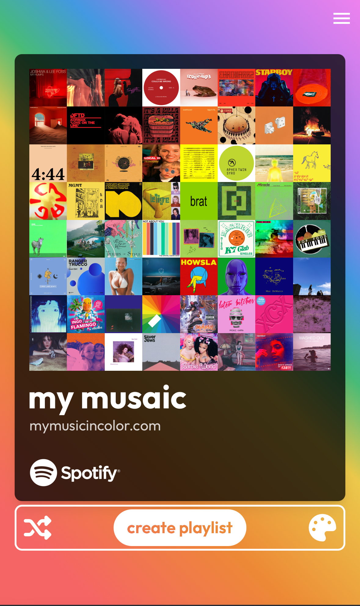
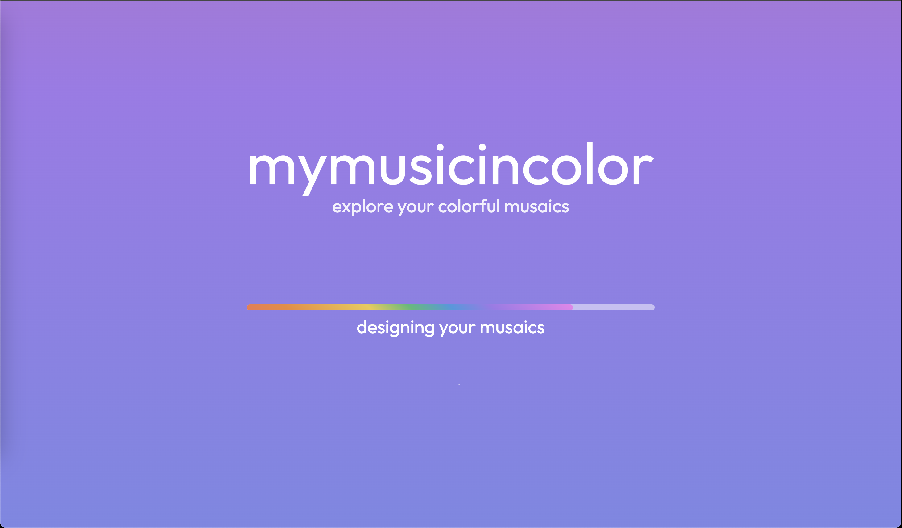

# MyMusicInColor

Turn your favorite tracks into colorful, shareable **musaics**

**Live app:** https://mymusicincolor.com

## Tech stack
- **Frontend:** Next.js, React, Tailwind CSS
- **API:** Spotify Web API
- **Image/Color:** ColorThief, html-to-image
- **Infra/Hosting:** Vercel

## App Preview

## App Demo Video

